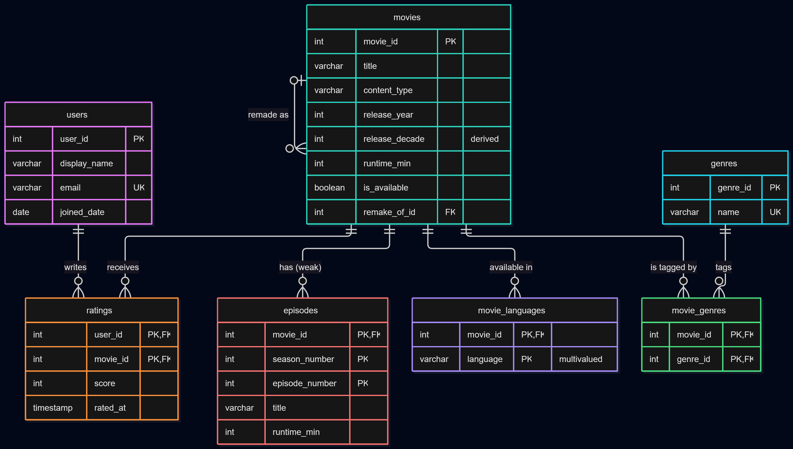

# EX603 Project: Movie Database

**Name:** Sinan Rahman  
**Chosen theme:** Movie / TV

This is a a relational database for a large-scale application where users rate movies and movies are classified by genre.

## Domain:  

The platform holds a catalogue of films and television titles and a population of registered users. The system has a catalogue of titles, and users who watch them and record what they thought. A user browses the catalogue, rates a title from
1 to 10, and can filter what they see by genre. The value of the platform comes
from aggregation where a large number of ratings could describe a film well enough to recommend it to someone else.

The design is driven by the questions the platform has to answer. What is the
average score for a given title, and how many ratings is that average based on?
Which titles in a genre rate highest? What has a particular user rated, and how
recently? Which titles are currently available? Each of those questions shaped
either an attribute or a constraint in the schema.

## Schema:



The full DDL is in [schema/schema.sql](schema/schema.sql). Seven tables:

| Table | Role / construct | What it holds |
|---|---|---|
| `users` | actor | Registered users |
| `movies` | producer | Films and TV series in the catalogue |
| `ratings` | event | One user's 1–10 score for one movie |
| `genres` | catalog | Genre categories |
| `movie_genres` | junction | Which genres each movie is tagged with |
| `movie_languages` | multivalued attribute | The languages a movie is available in |
| `episodes` | weak entity | Episodes of a series, keyed by series + season + episode number |

Design decisions to notice:
- `ratings` uses the composite key `(user_id, movie_id)`, so a user can only rate a movie once.
- `movies.remake_of_id` is a recursive foreign key linking a remake to its original (`ON DELETE SET NULL`).
- `movies.release_decade` is a derived attribute generated from `release_year`. Average score is computed at query time.
- Deleting a user cascades to their ratings, but deleting a movie that has ratings is restricted. Titles are hidden with `is_available` instead.
- CHECK constraints bound the score (1–10), release year, runtimes, episode numbers, and `content_type`.

Attribute definitions: [schema/schema-definition.md](schema/schema-definition.md)
Constraints and justifications: [schema/constraints.md](schema/constraints.md)
Modelling justification and reflection: [analysis/unit1.md](analysis/unit1.md)
DDL constraints table and CHECK reasoning: [analysis/unit2.md](analysis/unit2.md)

## Query catalogue:

## Technical highlights:

## What I would do differently:

## Video presentation:

## How to run:

```
createdb ex603_movies
psql -d ex603_movies -f schema/schema.sql
```

## AI Usage 
Assistance with Markdown formatting, mermaid.live ERD formatting, insight for deciding domains like movie release year,
insight into other approaches designers could make, specifically about my primary key.
