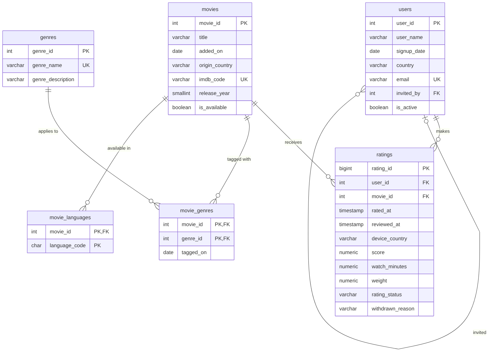

# EX603 Project: Movie Database

**Name:** Sinan Rahman  
**Chosen theme:** Movie / TV

A SQL analysis of a movie rating platform, tracking down why a dashboard reported a spam rate that was far too high, where the spam really comes from, and whether it is getting better or worse.

## Domain

The platform holds a catalogue of films and television titles and a population of registered users. Users watch titles, rate them, and can filter the catalogue by genre. The value of the platform comes from aggregation, where a large number of ratings describes a title well enough to recommend it to someone else.

Ratings do not always stay up. A rating can be published, flagged for review, or withdrawn, and withdrawn ratings record a reason such as spam, a policy violation, a duplicate, or the user's own request. Spam matters because reviewer payouts and recommendations both depend on the ratings being real.

The analysis follows one problem across the course. A dashboard reported that about half of all ratings were withdrawn as spam, and leadership froze reviewer payouts because of it. The questions the platform had to answer were: what is the real spam rate, which titles and users is it coming from, which titles are not being rated at all, and is the spam problem getting better or worse over time?

## Database overview



The queries run against the course's provided Movie/TV dataset. The DDL and data are in [data/movies.sql](data/movies.sql). The tables used in the analysis are:

| Table | Role | What it holds |
|---|---|---|
| `ratings` | event | 200 ratings from 2023, each with a score, status, and withdrawal reason if withdrawn |
| `movies` | producer | 15 titles, with release year and whether each is available |
| `users` | actor | 30 users who make the ratings |
| `genres` | catalog | 5 genres |
| `movie_genres` | junction | Which genres each title is tagged with |
| `movie_languages` | multivalued attribute | The languages a title is available in |

My own schema design for the theme, from Units 1 and 2, is in [schema/schema.sql](schema/schema.sql), with its ERD in [schema/erd.png](schema/erd.png), attribute definitions in [schema/schema-definition.md](schema/schema-definition.md), and constraints in [schema/constraints.md](schema/constraints.md).

## Query catalogue

### Unit 3

| Query | Business question |
|---|---|
| [3.1a](queries/unit3/q3_1.sql) | Which available titles were released after 2015, newest first? |
| [3.1b](queries/unit3/q3_1.sql) | Which rating statuses appear in the data? |
| [3.1c](queries/unit3/q3_1.sql) | Which ratings have a score between 1.0 and 2.5? |
| [3.1d](queries/unit3/q3_1.sql) | Which ratings were made from the US or the UK? |
| [3.1e](queries/unit3/q3_1.sql) | Which titles start with "Title_1"? |
| [3.1f](queries/unit3/q3_1.sql) | Which ratings have no withdrawal reason recorded? |
| [3.1g](queries/unit3/q3_1.sql) | What is every rating's withdrawal reason, with missing ones labeled? |
| [3.1h](queries/unit3/q3_1.sql) | What do published ratings look like in plain terms: payout score, watch hours, score category, time of day? |
| [3.2a](queries/unit3/q3_2.sql) | How many ratings does the dashboard's filter keep? |
| [3.2b](queries/unit3/q3_2.sql) | Which rows did that filter keep and drop, compared to the table total? |
| [3.2c](queries/unit3/q3_2.sql) | What does the repaired filter return? |
| [3.2d](queries/unit3/q3_2.sql) | Which ratings have a weighted score above 5? (alias in WHERE, which fails) |
| [3.2e](queries/unit3/q3_2.sql) | The same question, repeating the expression in WHERE. |
| [3.2f](queries/unit3/q3_2.sql) | The same question, computing the alias in a CTE. |
| [3.3a](queries/unit3/q3_3.sql) | Which users had a rating withdrawn as spam? (IN) |
| [3.3b](queries/unit3/q3_3.sql) | The same question. (CTE with WITH) |
| [3.3c](queries/unit3/q3_3.sql) | The same question. (EXISTS) |
| [3.3d](queries/unit3/q3_3.sql) | Do the three forms return the same users? |

### Unit 4

| Query | Business question |
|---|---|
| [4.1a](queries/unit4/q4_1.sql) | What are the count, total, average, minimum, and maximum score across all ratings, and how many users rated? |
| [4.1a check](queries/unit4/q4_1.sql) | Where does the minimum score come from? |
| [4.1b](queries/unit4/q4_1.sql) | How many ratings does each title have, and what is its average score? |
| [4.1c](queries/unit4/q4_1.sql) | Which titles have enough ratings for their spam rate to mean anything? |
| [4.1d](queries/unit4/q4_1.sql) | How do ratings break down by region and status? |
| [4.2A](queries/unit4/q4_2.sql) | For each title, how many ratings are there and how many were spam? |
| [4.2B](queries/unit4/q4_2.sql) | What is the spam rate for each region and for the whole platform? |
| [4.2C](queries/unit4/q4_2.sql) | What is the normal spam rate for a high-volume title? |

### Unit 5

| Query | Business question |
|---|---|
| [5.1a](queries/unit5/q5_1.sql) | Who made each rating, for which title, and when? |
| [5.1b](queries/unit5/q5_1.sql) | Which genres are the two high-spam titles tagged with? |
| [5.1c](queries/unit5/q5_1.sql) | Which titles share the Comedy tag with them? |
| [5.1d](queries/unit5/q5_1.sql) | How do the high-spam titles compare with other titles released the same year? |
| [5.2A-1](queries/unit5/q5_2.sql) | How many ratings does every title have, including titles with none? (LEFT JOIN) |
| [5.2A-2](queries/unit5/q5_2.sql) | The same question with an INNER JOIN. |
| [5.2A-3](queries/unit5/q5_2.sql) | How many titles does the INNER JOIN leave out? |
| [5.2B-1](queries/unit5/q5_2.sql) | The same LEFT JOIN written as a RIGHT JOIN. |
| [5.2B-2](queries/unit5/q5_2.sql) | Do the LEFT JOIN and RIGHT JOIN return the same rows? |
| [5.2B-3](queries/unit5/q5_2.sql) | Every title and every rating, matched or not. (FULL OUTER JOIN) |
| [5.2B-4](queries/unit5/q5_2.sql) | How many rows of the full outer join are matched or unmatched? |
| [5.2C-1](queries/unit5/q5_2.sql) | Which titles have never been rated? (NOT EXISTS) |
| [5.2C-2](queries/unit5/q5_2.sql) | The same question. (EXCEPT) |
| [5.3A-1](queries/unit5/q5_3.sql) | Every possible pairing of a genre and a title. (CROSS JOIN) |
| [5.3A-2](queries/unit5/q5_3.sql) | Does the CROSS JOIN row count equal the two table counts multiplied? |
| [5.3B](queries/unit5/q5_3.sql) | How does PostgreSQL plan to run the three-table join? (EXPLAIN) |

### Unit 6

| Query | Business question |
|---|---|
| [6.1a](queries/unit6/q6_1.sql) | Is a rating unusual for its own title? Every rating next to its title's average. |
| [6.1a GROUP BY](queries/unit6/q6_1.sql) | The same averages with GROUP BY, to compare row counts. |
| [6.1b](queries/unit6/q6_1.sql) | How would a most-rated titles leaderboard handle ties? (ROW_NUMBER, RANK, DENSE_RANK) |
| [6.1c](queries/unit6/q6_1.sql) | Which titles fall in each quarter by number of ratings? (NTILE) |
| [6.2A](queries/unit6/q6_2.sql) | Are Title_02's scores going up or down from one rating to the next? (LAG, LEAD) |
| [6.2B](queries/unit6/q6_2.sql) | Is rating activity on track for 50 ratings per quarter? (running total, moving average) |
| [6.2C](queries/unit6/q6_2.sql) | Which titles went 90 days or more without a rating? |
| [6.2C check](queries/unit6/q6_2.sql) | Did Title_09 stop getting ratings, or did the platform stop recording them? |
| [6.3A](queries/unit6/q6_3.sql) | What are the three highest ratings for each title? |
| [6.3B](queries/unit6/q6_3.sql) | Is the spam rate getting better or worse each month? |
| [6.3B check](queries/unit6/q6_3.sql) | Is any month missing from the monthly series? |

## Technical highlights

- Handling NULL in filters (Unit 3). The dashboard filtered with `withdrawn_reason <> 'User request'`, which silently drops every rating with no withdrawal reason, because a comparison with NULL is never true. Repairing it with `OR withdrawn_reason IS NULL` took the count from 27 ratings to 193 and the spam rate from about 44% to 6%.
- Conditional aggregation with ROLLUP (Unit 4). Counting spam with `SUM(CASE ...)` inside a `GROUP BY ROLLUP` gave the spam rate per region and the platform total in one query, which showed spam ranged from about 2% to 10% by region, so it did not need a regional response.
- Outer joins and NOT EXISTS (Unit 5). An inner join only returns titles that have ratings, so two titles nobody had rated never showed up in any report. A LEFT JOIN and NOT EXISTS found them.
- Window functions with a CTE (Unit 6). LAG partitioned by title found the gaps between ratings, and computing it in a CTE let the outer query keep only the long gaps, since a window function result cannot be filtered with WHERE in the same query. LAG over a monthly series gave the month-over-month spam rate, with a check that no month was missing.

## Findings and recommendations

- The real spam rate is about 6%, not 50%. The dashboard's filter dropped every rating with no withdrawal reason. Counted correctly, 12 of 200 ratings were spam. I recommended lifting the payout freeze and replacing the dashboard's calculation.
- Spam is concentrated on a few titles and accounts, and it went down over the year. Title_02 and Title_03 had the highest spam rates, and other titles with the same genre and release year had little or none, which points to the accounts more than the titles. By quarter, the spam rate fell from 7.5% to 4.2%. I recommend continuing the review of Title_02, where spam kept coming back all year, and reporting spam as a three-month moving rate instead of a monthly one.
- Two titles have never been rated. Title_14 and Title_15 have no genre tags, so users browsing by genre would not find them. I recommend having the catalogue team tag them and check that they show up in search.

The full memos are in [analysis](analysis), one per unit from Unit 3 on.

## Limitations and future improvements

The dataset covers one year and only 200 ratings, with 12 of them spam. That is enough to find the counting error and the titles involved, but too few to say the spam trend is real. One or two spam ratings can move a month's rate by more than 10 points. Another year of ratings, or the full rating history from the live platform, would show whether the drop holds. The data also only stores whether each title is available right now, so I could not tell whether Title_09's 113-day gap was caused by the title being hidden. A history of catalogue changes would answer that.

## Video presentation

[Watch the presentation](VIDEO_LINK_HERE)

## How to run

You need PostgreSQL 14 or later. Load the dataset into a new database, then run any query file against it:

```
createdb ex603_data
psql -d ex603_data -f data/movies.sql
psql -d ex603_data -f queries/unit6/q6_1.sql
```

To create my own schema design from Units 1 and 2 instead, in a separate database:

```
createdb ex603_movies
psql -d ex603_movies -f schema/schema.sql
```

## AI Usage

Assistance with Markdown formatting, mermaid.live ERD formatting, insight for deciding domains like movie release year,
insight into other approaches designers could make, specifically about my primary key. For Unit 6, Claude helped draft the queries and write-ups, which I ran against the dataset and checked.
